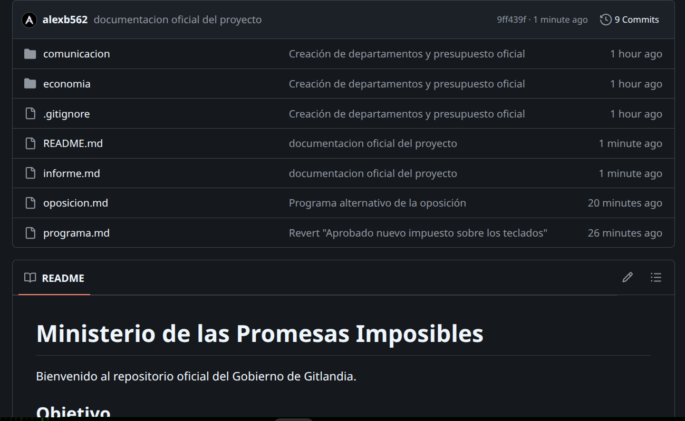
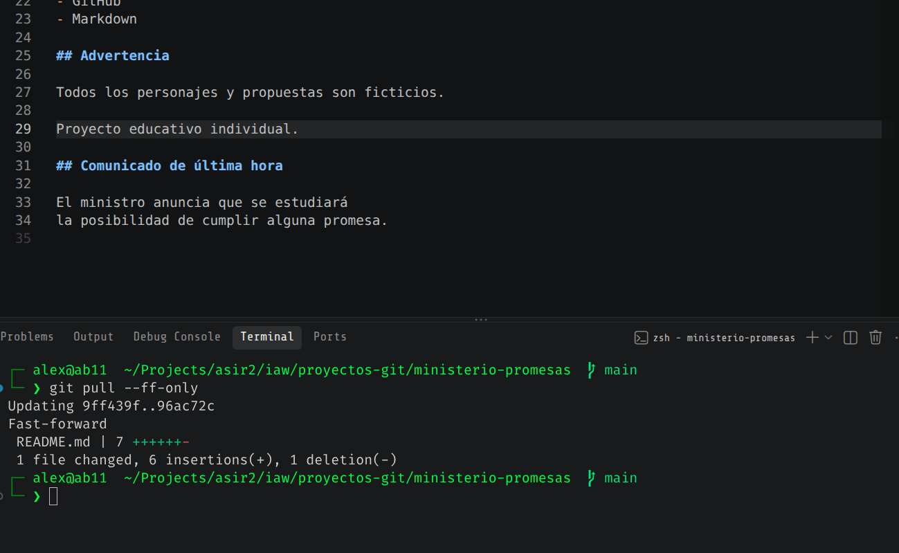
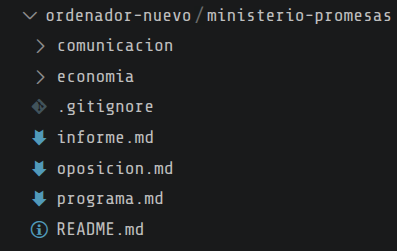

# Operación MONCLOA.GIT — El Ministerio de las Promesas Imposibles

## Introducción
El Gobierno de la República de Gitlandia acaba de crear el Ministerio de las Promesas Imposibles, una institución encargada de desarrollar un programa electoral que cambiará constantemente. El problema es que cada cambio que hace un político se sobreescribe cada cambio anterior. Nuestro equipo ha sido contratado para desarrollar un sistema Git para seguir los cambios y implementar un control de versiones que guarda la historia de cambios.

## Objetivos
Instalar y configurar Git desde la terminal.
Crear e inicializar un repositorio local.
Comprender el directorio de trabajo, el área de preparación (staging) y los commits.
Añadir, modificar, eliminar y recuperar archivos.
Consultar el historial y comparar versiones.
Utilizar .gitignore para excluir determinados archivos.
Crear y utilizar ramas individualmente.
Trabajar con un repositorio remoto en GitHub.
Subir, descargar y sincronizar cambios.
Clonar un repositorio y continuar trabajando sobre él.

## Entorno de trabajo
Ubuntu 26 con VSCode como editor de archivos

---

## Fase 1. Preparación del entorno

### Paso 1. Comprobar si Git está instalado
```sh
git --version
```
```
 git version 2.53.0
```

### Paso 2. Configurar nuestra identidad
```sh
git config --global user.name "Tu Nombre"
git config --global user.email "tu-correo@example.com"
```
- Eso determina el autor que se va a usar para cada commit 

```sh
git config --global --list
```
- para ver el usuario que se va a usar
```
credential.helper=store
user.email= APARECERÁ CORREO
user.name= APARECERÁ USUARIO
...skipping...
credential.helper=store
user.email= APARECERÁ CORREO
user.name= APARECERÁ USUARIO
```

```sh
git config --global init.defaultBranch main
```
- Crea la rama inciial predeterminada


### Paso 3. Crear nuestro espacio de trabajo

```sh
mkdir -p ~/proyectos-git
cd ~/proyectos-git

mkdir ministerio-promesas
cd ministerio-promesas
```

- Comprobar el contenido del directorio
```sh
ls -la
```
```
total 16
drwxrwxr-x 2 alex alex 4096 Oct 29 08:50 .
drwxrwxr-x 3 alex alex 4096 Oct 29 09:03 ..
-rw-rw-r-- 1 alex alex 4808 Oct 29 09:02 README.md
```


### Paso 4. Inicializar un repositorio
```sh
git init -b main
```
- Se convierte un directorio normal en uno de Git

```
Initialized empty Git repository in DIRECTORIO/.git/
```
Y haciendo un `ls -la`
total 20
drwxrwxr-x 3 alex alex 4096 Oct 29 09:08 .
drwxrwxr-x 3 alex alex 4096 Oct 29 09:03 ..
drwxrwxr-x 6 alex alex 4096 Oct 29 09:08 .git
-rw-rw-r-- 1 alex alex 4808 Oct 29 09:02 README.md

- Se ha creado una carpeta oculta que gestiona el repositorio que hemos creado

```sh
git status
```
```
On branch main

No commits yet

Untracked files:
  (use "git add <file>..." to include in what will be committed)
        README.md

nothing added to commit but untracked files present (use "git add" to track)
```
- Dice que no se ha hecho ningún commit 

### Analisis
Git funciona completamente en local. Sigue todos los cambios desde la carpeta que hemos creado de .git. Solo se necesitaría internet si quisieramos conectarlo a un servicio remoto cómo GitHub. Borrando .git quitaría el seguimiento del directorio. 


---

## Fase 2. Primer programa electoral

### Paso 5. Crear el documento oficial
```sh
nano programa.md
```
```
# Programa Electoral de Gitlandia

## Elecciones Generales

Presidente: Don Commit Permanente

## Promesas oficiales

1. WiFi gratis en todo el país.
2. Los lunes serán festivos.
3. Cada ciudadano tendrá un robot asistente.
4. Los exámenes serán voluntarios.
5. Las impresoras funcionarán siempre.

## Lema

"Prometemos hasta que se llene el disco duro".
```

### Paso 6. Consultar el estado del repositorio
```sh
git status
```
```
On branch main

No commits yet

Untracked files:
  (use "git add <file>..." to include in what will be committed)
        README.md
        programa.md

nothing added to commit but untracked files present (use "git add" to track)
```
- Vemos que se ha detectado el nuevo archivo, pero por ahora no hemos hecho un add para empezar el seguimiento. 


### Paso 7. Registrar el primer commit

```sh 
git add programa.md
git status
```
```
On branch main

No commits yet

Changes to be committed:
  (use "git rm --cached <file>..." to unstage)
        new file:   programa.md

Untracked files:
  (use "git add <file>..." to include in what will be committed)
        README.md
```
- Ahora vemos que hemos dicho a Git que empiece a seguir el nuevo documento. 

```sh
git commit -m "Primer programa electoral de Gitlandia"
```

```
[main (root-commit) 799ade1] Primer programa electoral de Gitlandia
 1 file changed, 17 insertions(+)
 create mode 100644 programa.md
 ```
 ```sh
 git log --oneline
```
```
commit 799ade11fdaef8aea03278b987dba33e9489c94e (HEAD -> main)
Author: AUTOR CON CORREO
Date:   Thu Oct 29 09:22:48 2026 +0100

    Primer programa electoral de Gitlandia
```
- Se ha registrado el commmit

---

## Fase 3. Primer escándalo: las promesas cambian

### Paso 8. Modificar una promesa
- El Ministerio ha cambiado la línea de lunes de festivos a "Los lunes serán festivos únicamente si no hay trabajo pendiente." Cambia la línea, guardarla y usar 
```sh
git diff
``` 
para ver la diferencia.

```
-2. Los lunes serán festivos.
+2. Los lunes serán festivos únicamente si no hay trabajo pendiente.
```
- Se ve que se ha quitado una línea y se ha añadido otra. 

```sh
git add programa.md

git commit -m "Economía limita los lunes festivos"
```
```sh
git log --oneline
```
```
commit 03499f8cebfc17010cc1707e55216c40c7a7ea7a (HEAD -> main)
Author: AUTOR Y CORREO
Date:   Thu Oct 29 09:30:28 2026 +0100

    Economía limita los lunes festivos

commit 799ade11fdaef8aea03278b987dba33e9489c94e
Author: AUTOR Y CORREO
Date:   Thu Oct 29 09:22:48 2026 +0100

    Primer programa electoral de Gitlandia
```

### Paso 9. Segunda modificación: llega la oposición
Añade al final:
```
## Nuevas medidas

6. Un unicornio eléctrico para cada familia.
7. Internet gratuito incluso dentro de los túneles.
8. Los atascos serán declarados ilegales.
9. Se eliminarán los errores 404 por decreto.
```
Ejecuta

```sh
git status
git diff
```
```
diff --git a/programa.md b/programa.md
index f6d5272..abd77b7 100644
--- a/programa.md
+++ b/programa.md
@@ -15,3 +15,10 @@ Presidente: Don Commit Permanente
 ## Lema
 
 "Prometemos hasta que se llene el disco duro".
+
+## Nuevas medidas
+
+6. Un unicornio eléctrico para cada familia.
+7. Internet gratuito incluso dentro de los túneles.
+8. Los atascos serán declarados ilegales.
+9. Se eliminarán los errores 404 por decreto.
```
- Ha visto el cambio que hemos hecho

Hacer el stage
```sh
git add programa.md
```
y observar qué se va a registrar
```sh
git diff --staged
```
```
diff --git a/programa.md b/programa.md
index f6d5272..abd77b7 100644
--- a/programa.md
+++ b/programa.md
@@ -15,3 +15,10 @@ Presidente: Don Commit Permanente
 ## Lema
 
 "Prometemos hasta que se llene el disco duro".
+
+## Nuevas medidas
+
+6. Un unicornio eléctrico para cada familia.
+7. Internet gratuito incluso dentro de los túneles.
+8. Los atascos serán declarados ilegales.
+9. Se eliminarán los errores 404 por decreto.
```

y finalmente
```sh
git commit -m "Ampliación del programa con medidas revolucionarias"
```


### Preguntas
Git diff muestra todos los cambios que no tienen el staging, es decir que no hemos hecho `git add`.  La opción `--staged` muestra los cambios que tienen staging, es decir los que están listos para un commit. Nos da la oportunidad de ver los cambios propuestos antes de hacer un commit por si hemos cometido un error o hay algo que no queremos comitear. 


---

## Fase 4. El presupuesto secreto
Crear varias otras carpetas para departamentos
```sh
mkdir -p economia comunicacion secretos
```


### Paso 10. Crear varios documentos
Crear un archivo de presupuesto
```sh
cat > economia/presupuesto.txt <<'EOF'
PRESUPUESTO GENERAL DE GITLANDIA

WiFi nacional: 500 millones
Unicornios eléctricos: 800 millones
Robot por ciudadano: 2000 millones
Publicidad institucional: 9000 millones

Total: pendiente de calcular
EO
```

Y un comunicado oficial
```sh
cat > comunicacion/nota.txt <<'EOF'
COMUNICADO DEL GOBIERNO

El presupuesto está perfectamente controlado.
Las calculadoras de la oposición están manipuladas.
EOF
```
Y un documento secreto
```sh
echo "Clave ficticia de demostración: VOTO123" > secretos/claves.txt
```

### Paso 11. Evitar archivos innecesarios con .gitignore
```sh
nano .gitignore
```
Es una lista de archivos que serán excluidos cuando hacemos un commit
Añade a la lista:
```
# Documentos internos ficticios
secretos/

# Archivos temporales
*.tmp

# Copias de seguridad
*.bak

# Configuraciones locales
.env
```
```sh
git status
```
```
On branch main
Untracked files:
  (use "git add <file>..." to include in what will be committed)
        .gitignore
        README.md
        comunicacion/
        economia/

nothing added to commit but untracked files present (use "git add" to track)
```
- Vemos que el directorio secretos no se va a publicar porque lo hemos puesto en gitignore.

Se puede verificar la regla:
```sh
git check-ignore -v secretos/claves.txt
```

```
.gitignore:2:secretos/  secretos/claves.txt
```
está incluido en el gitignore.

Ahora publicar los documentos públicos y las reglas de exclusión
```sh
git add .gitignore economia/ comunicacion/

git status

git commit -m "Creación de departamentos y presupuesto oficial"
```


---

## Fase 5. Crisis institucional: recuperar los errores
Añade un cambio sospechoso al presupuesto
```sh
echo "TODO EL PRESUPUESTO PARA HELADOS" > economia/presupuesto.txt
```

```sh
cat economia/presupuesto.txt
```
```
TODO EL PRESUPUESTO PARA HELADOS
```

### Paso 12. Recuperar un archivo modificado
```sh
git restore economia/presupuesto.txt
```
Vuelve a comprobar
```sh

```sh
cat economia/presupuesto.txt
```

```
PRESUPUESTO GENERAL DE GITLANDIA

WiFi nacional: 500 millones
Unicornios eléctricos: 800 millones
Robot por ciudadano: 2000 millones
Publicidad institucional: 9000 millones

Total: pendiente de calcular
```

- Git ha descartado el último cambio 

### Paso 13. Recuperar un archivo eliminado
```sh
rm comunicacion/nota.txt
```

```sh
git status
```
```
On branch main
Changes to be committed:
  (use "git restore --staged <file>..." to unstage)
        new file:   README.md

Changes not staged for commit:
  (use "git add/rm <file>..." to update what will be committed)
  (use "git restore <file>..." to discard changes in working directory)
        deleted:    comunicacion/nota.txt
```
Recuperar el documento

```sh
git restore comunicacion/nota.txt
```

y comprobar que existe de nuevo

```sh
ls comunicacion/
cat comunicacion/nota.txt
```


### Paso 14. Quitar un cambio del staging

Preparar un cambio accidental

```sh
echo "Impuesto por respirar aire premium" >> economia/presupuesto.txt
git add economia/presupuesto.txt
git status
```

```
On branch main
Changes to be committed:
  (use "git restore --staged <file>..." to unstage)
        new file:   README.md
        modified:   economia/presupuesto.txt

Changes not staged for commit:
  (use "git add <file>..." to update what will be committed)
  (use "git restore <file>..." to discard changes in working directory)
        modified:   README.md
```
- Se ha modificado el archivo con el cambio accidental y se ha hecho un add

Restaurar

```sh
git restore --staged economia/presupuesto.txt
git status
cat economia/presupuesto.txt
```

```
On branch main
Changes to be committed:
  (use "git restore --staged <file>..." to unstage)
        new file:   README.md

Changes not staged for commit:
  (use "git add <file>..." to update what will be committed)
  (use "git restore <file>..." to discard changes in working directory)
        modified:   README.md
        modified:   economia/presupuesto.txt
```
- Se ha quitado el documento del staging. La modificación sigue allí hasta que hagamos un restore normal. 

```sh
git restore economia/presupuesto.txt
```
Y ver el contenido con cat

```
PRESUPUESTO GENERAL DE GITLANDIA

WiFi nacional: 500 millones
Unicornios eléctricos: 800 millones
Robot por ciudadano: 2000 millones
Publicidad institucional: 9000 millones

Total: pendiente de calcular
```
- Hemos vuelto a la versión original. 


### Explicación de los incidentes
restore - descarta cambios que no están en staging. Se puede usar para restaurar cambios o borrados que no han entrado ya en staging
restore --staged - descarta cambios que están en staging (ya ha hecho un add). Funciona si haces un add y te das cuenta de un error


---

## Fase 6. La hemeroteca: Git nunca olvida

### Paso 15. Investigar el historial de promesas
```sh
git log --oneline
```
```
20e3c08 (HEAD -> main) Creación de departamentos y presupuesto oficial
f3f52ea Ampliación del programa con medidas revolucionarias
03499f8 Economía limita los lunes festivos
799ade1 Primer programa electoral de Gitlandia
```
Vemos aquí el historial de commits. 

### Paso 16. Comparar dos momentos de la historia
```sh
# ver el ultimo commit actual
git show HEAD


# consultar la version anterior
git show HEAD~1

# comprobar el cuarto commit (tres commits antes del actual)
git show HEAD~3:programa.md
```

Ahora podemos comprobar los cambios entre commits con respeto al programa
```sh
# Estamos viendo los cambios entre la primera version y la ultima
git diff 799ade1 20e3c08 -- programa.md
```
```
index 5dd03fc..abd77b7 100644
--- a/programa.md
+++ b/programa.md
@@ -7,7 +7,7 @@ Presidente: Don Commit Permanente
 ## Promesas oficiales
 
 1. WiFi gratis en todo el país.
-2. Los lunes serán festivos.
+2. Los lunes serán festivos únicamente si no hay trabajo pendiente.
 3. Cada ciudadano tendrá un robot asistente.
 4. Los exámenes serán voluntarios.
 5. Las impresoras funcionarán siempre.
@@ -15,3 +15,10 @@ Presidente: Don Commit Permanente
 ## Lema
 
 "Prometemos hasta que se llene el disco duro".
+
+## Nuevas medidas
+
+6. Un unicornio eléctrico para cada familia.
+7. Internet gratuito incluso dentro de los túneles.
+8. Los atascos serán declarados ilegales.
+9. Se eliminarán los errores 404 por decreto.
~
```


### Investigación periodística
El gobierno prometió originalmente que todos los lunes serán festivos, pero lo cambió a solo si no hay trabajo pendiente. Pasó ente el commit con id 5dd03fc y abd77b7. Si quisieramos recuperar la versión original sin modificar el proyecto entero, habría que usar:

```sh
git restore --source=<commit_id> -- programa.md
```
incluyendo el ID de la versión a la que queremos volver.


---

## Fase 7. El Gobierno comete un error histórico

### Paso 17. Registrar una medida equivocada
Introducir una cláusula errónea

```sh
echo "10. Impuesto de 100 euros por utilizar el teclado." >> programa.md
git add programa.md
git commit -m "Aprobado nuevo impuesto sobre los teclados"
```

Anular la cláusula guardando la evidencia de la aprobación

```sh
git revert --no-edit HEAD
```
```
[main a60d095] Revert "Aprobado nuevo impuesto sobre los teclados"
 Date: Thu Oct 29 10:49:14 2026 +0100
 2 files changed, 516 deletions(-)
 delete mode 100644 README.md
```
Comprobamos el historial
```sh
git log --oneline
```
```
a60d095 (HEAD -> main) Revert "Aprobado nuevo impuesto sobre los teclados"
7f879df Aprobado nuevo impuesto sobre los teclados
20e3c08 Creación de departamentos y presupuesto oficial
f3f52ea Ampliación del programa con medidas revolucionarias
03499f8 Economía limita los lunes festivos
799ade1 Primer programa electoral de Gitlandia
```
- Se ve tanto el commit original como que se ha restaurado la versión original. 


### Explicación del incidente
Es muy importante si hay que documentar cada paso para fines legales y para mostrar que se ha restaurado un estado, mostrando la evidencia de la restauración. Ya que Git se usa mucho en equipo, puede dar mucho contexto a otros miembros del equipo si hay problemas en el futuro. 


---

## Fase 8. Crear una rama: el programa electoral alternativo

### Paso 18. Crear el programa de la oposición
```sh
git switch -c oposicion
git branch
```
```
  main
* oposicion
```
Crear un nuevo archivo

```sh
cat > oposicion.md <<'EOF'
# Programa de la oposición

Partido del Código Libre

1. Prohibir las reuniones que pudieron ser un correo.
2. Obligar a que todos los políticos usen Linux.
3. Convertir el Congreso en un servidor de Minecraft.
4. Que los ministros aprueben un examen de informática.
5. Sustituir los discursos por mensajes de 140 caracteres.
EOF
```

Hacer un commit

```sh
git add oposicion.md

git commit -m "Programa alternativo de la oposición"
```

Comprueba

```sh
git log --oneline
```

```
88e20cb (HEAD -> oposicion) Programa alternativo de la oposición
...
```

### Paso 19. Volver al Gobierno
Volver a la rama principal

```sh
git switch main
```
Y comprobar el contenido con ls

```
README.md  comunicacion  economia  programa.md  secretos
```
No aparece oposicion.md porque fue creado en otra rama. 

### Paso 20. Fusionar la oposición con el Gobierno
```sh
git merge oposicion
```
y comprobar el contenido con ls

```
README.md  comunicacion  economia  oposicion.md  programa.md  secretos
```
Ahora aparece. Además con 

```sh
git log --oneline --graph --all --decorate
```
```
* 88e20cb (HEAD -> main, oposicion) Programa alternativo de la oposición
```
Podemos ver que en el commit actual se ha hecho un merge con las 2 ramas.


---

## Fase 9. Llega la revolución: publicar en GitHub

### Paso 21. Crear una cuenta en GitHub

### Paso 22. Vincular Git local con GitHub
Copia el enlace HTTPS que proporciona el GitHub y insertalo en este comando
```sh
git remote add origin https://github.com/alexb562/ministerio-promesas.git
```
Comprueba las ubicaciones remotas
```sh
git remote -v
```
```
origin  https://github.com/alexb562/ministerio-promesas.git (fetch)
origin  https://github.com/alexb562/ministerio-promesas.git (push)
```

### Paso 23. Publicar el primer repositorio
```sh
git push -u origin main
```
Establece una conexión entre la rama local y la rama remota

### Paso 24. Comprobar la publicación

No se ha publicado el directorio de secretos.

### Paso 25. Crear un README para los visitantes
Crea en local:
```
# Ministerio de las Promesas Imposibles

Bienvenido al repositorio oficial del Gobierno
de Gitlandia.

## Objetivo

Aprender Git mediante un programa electoral
ficticio que cambia constantemente.

## Archivos

- programa.md: Programa electoral oficial.
- oposicion.md: Propuestas de la oposición.
- economia/: Presupuestos.
- comunicacion/: Comunicados oficiales.

## Tecnología

- Linux
- Git
- GitHub
- Markdown

## Advertencia

Todos los personajes y propuestas son ficticios.

Proyecto educativo individual.
```
Manda los cambios
```sh
git add README.md

git commit -m "Documentación oficial del repositorio"

git push
```


## Fase 10. Sincronización y clonación

### Paso 26. Simular una modificación desde otro ordenador
Entra en GitHub y hacer una edición directamente desde el browser poniendo
```
## Comunicado de última hora

El ministro anuncia que se estudiará
la posibilidad de cumplir alguna promesa.
```

### Paso 27. Descargar los cambios
```sh
git fetch origin
```
y comprobar los cambios

```sh
git log --oneline HEAD..origin/main
```
```
96ac72c (origin/main, origin/HEAD) mensaje de ultimo minuto
```
- Se ve que ha visto el cambio el remoto que es diferente de lo que tenemos en local. Fetch descarga los commits pero no cambia nada en la rama. Pull integra los cambios y push empuje los cambios a remoto.



### Paso 28. Clonar el proyecto en otro directorio

```sh
cd ~/proyectos-git
mkdir ordenador-nuevo
cd ordenador-nuevo
```

y clonar en el directiorio 
```sh
git clone https://github.com/alexb562/ministerio-promesas.git
```

- Se ha clonado todos los archivos que no están en el gitignore.

### Última misión
En el directorio clonado añade esto al README
```
El Ministerio sobrevive al cambio de ordenador
```
Hacer el commit y push
```sh
git add README.md

git commit -m "El Ministerio sobrevive al cambio de ordenador"

git push
```
Volver al repo original y hacer
```sh
git pull --ff-only
```
```
remote: Enumerating objects: 5, done.
remote: Counting objects: 100% (5/5), done.
remote: Compressing objects: 100% (1/1), done.
remote: Total 3 (delta 2), reused 3 (delta 2), pack-reused 0 (from 0)
Unpacking objects: 100% (3/3), 333 bytes | 333.00 KiB/s, done.
From https://github.com/alexb562/ministerio-promesas
   96ac72c..4168675  main       -> origin/main
Updating 96ac72c..4168675
Fast-forward
 README.md | 3 +++
 1 file changed, 3 insertions(+)
```
```sh
cat README.md
```
```
# Ministerio de las Promesas Imposibles

Bienvenido al repositorio oficial del Gobierno
de Gitlandia.

## Objetivo

Aprender Git mediante un programa electoral
ficticio que cambia constantemente.

## Archivos

- programa.md: Programa electoral oficial.
- oposicion.md: Propuestas de la oposición.
- economia/: Presupuestos.
- comunicacion/: Comunicados oficiales.

## Tecnología

- Linux
- Git
- GitHub
- Markdown

## Advertencia

Todos los personajes y propuestas son ficticios.

Proyecto educativo individual.

## Comunicado de última hora

El ministro anuncia que se estudiará
la posibilidad de cumplir alguna promesa.


El Ministerio sobrevive al cambio de ordenador% 
```
El documento con el último cambio está allí.

---

## Fase 11. El examen del ministro

### Misiones finales

1. Crear `ministros.md` y registrar un commit.
```sh
git log --oneline
```
```
e3251b6 (HEAD -> main) ministros anadidos
```
```sh
git add ministros.md
git commit -m "ministros anadidos"
```


2. Añadir una promesa, comprobar los cambios y registrarlos.
```sh
git diff programa.md
```
```
diff --git a/programa.md b/programa.md
index abd77b7..520ebbf 100644
--- a/programa.md
+++ b/programa.md
@@ -22,3 +22,4 @@ Presidente: Don Commit Permanente
 7. Internet gratuito incluso dentro de los túneles.
 8. Los atascos serán declarados ilegales.
 9. Se eliminarán los errores 404 por decreto.
+10. NUEVO AÑADIDO - TENDREMOS MÁS PROYECTOS
\ No newline at end of file
```
```sh
git add programa.md
git commit -m "Anadir nueva promesa electoral"
```

3. Recuperar el presupuesto después de una modificación accidental.

```sh
git status
```
```
Changes not staged for commit:
  (use "git add <file>..." to update what will be committed)
  (use "git restore <file>..." to discard changes in working directory)
        modified:   economia/presupuesto.txt
        modified:   informe.md

no changes added to commit (use "git add" and/or "git commit -a")
```
```sh
 git restore economia/presupuesto.txt 
 ```
```sh
git status
```
```

Changes not staged for commit:
  (use "git add <file>..." to update what will be committed)
  (use "git restore <file>..." to discard changes in working directory)
        modified:   informe.md
```


4. Comprobar que Git ignora `discurso.tmp`.
```sh
git status --ignored
```
```
Ignored files:
  (use "git add -f <file>..." to include in what will be committed)
        discurso.tmp
        secretos/
```


5. Crear la rama `reforma` y fusionarla con `main`.


```sh
git switch -c reforma
touch presupuestoReforma.md
git add presupuestoReforma.md
git commit -m "presupuesto de reforma hecho"
git switch main
git merge reforma
git log --oneline --graph --all --decorate
```
```
* 05bf82f (HEAD -> main, reforma) presupuesto de reforma hecho
```

6. Publicar los cambios y comprobar la sincronización.
7. Mostrar el historial completo con un gráfico de commits.

### Capturas

---

## Conclusión

## Repositorio de GitHub

## Referencias